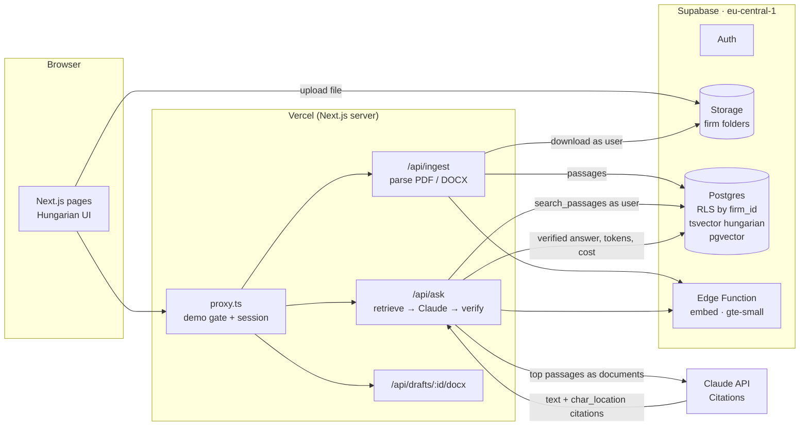

# Verdictum POC

[](https://github.com/getupworkdev/verdictum-poc/actions/workflows/ci.yml)

> **Demo project built for Verdictum's proposal – sample data only.**
> Every firm, person, company, contract and letter in this repository is fictional. No real client data was used.

A small, working slice of a Hungarian legal document platform. It covers the parts of Verdictum's brief that are hardest to get right:

- **firm isolation** enforced by the database
- **answers tied to exact source passages**, with every citation checked on the server
- **Hungarian full-text search** that understands inflected word forms
- **template drafting** with versions, diff and DOCX export
- **AI cost visibility** per analysis, case and firm

The interface is Hungarian throughout.

**Stack:** Next.js 16 (App Router, TypeScript) · Supabase (Postgres, pgvector, Storage, Auth, Edge Functions) in the EU (Frankfurt) · Claude API (server-side only) · Vercel.

## What it does

| Feature | Where | How |
| --- | --- | --- |
| Two firms, strictly separated | everywhere, plus the **Izolációs teszt** page | RLS on every table by `firm_id`; composite foreign keys `(case_id, firm_id)`. The isolation page runs the "attacks" live as the signed-in user. |
| Upload PDF / DOCX | case → Dokumentumok | The browser uploads to a private Storage bucket (firm folder, 5 MB). The server parses it into passages with page and paragraph numbers, then stores the passages and their embeddings. Limits: 5 MB, 30 pages. |
| Hybrid search | case → Keresés | Postgres `to_tsvector('hungarian', …)` plus pgvector cosine similarity, fused with reciprocal rank fusion, always filtered by `case_id`. *szerződés / szerződésben / szerződést* all match each other. |
| Q&A with citations | case → Kérdés (AI) | The top passages go to Claude as separate documents with Citations enabled. Each sentence shows clickable source chips; the side panel shows the exact passage and page with the quoted span highlighted. |
| Citation verification | server, `src/lib/citations.ts` | Every cited span must exist **verbatim** in the passage it points to. If it doesn't, the sentence is marked **Nem igazolt** (red). A claim with no citation is marked **Hiányzó bizonyíték**. If nothing in the case is relevant, the model isn't called at all. |
| Drafting | case → Tervezetek | Two Hungarian templates (*fizetési felszólítás*, *szerződésmódosítás*) filled from the case facts. Missing facts stay visible as `[[hiányzik: …]]`. Versions are insert-only, any two can be diffed, and each exports to DOCX. |
| Cost panel | case → Költségek, and Költségek | Input/output tokens and estimated USD per analysis, per case and per firm (views with `security_invoker`, so RLS applies). |
| Safety | | A demo password gate in front of the whole app; rate limits stored in Postgres (20 questions per hour per IP, plus upload and search limits); the Claude key in server env only; upload size, type and page limits. |

## Architecture



Every database call from a request runs **as the signed-in user** (their JWT), so RLS applies even to code paths that forget a filter. The service-role key is used for only three things: the rate limiter, the seed script, and looking up the *other* firm's case id on the isolation page, so the page can show that knowing an id is not enough.

### How isolation works

```sql
-- the user's firm, resolved from their JWT
create function current_firm_id() returns uuid security definer
  as $$ select firm_id from public.users where id = auth.uid() $$;

create policy cases_own_firm on cases for all to authenticated
  using (firm_id = current_firm_id()) with check (firm_id = current_firm_id());
```

The same policy covers documents, passages, analyses and drafts; drafts are insert-only, so old versions can't be rewritten. Child tables reference `(case_id, firm_id)` rather than just `case_id`, so even a forged `firm_id` can't attach a row to another firm's case. Storage objects live under `<firm_id>/<case_id>/…`, with policies on the first folder segment. The search function is `SECURITY INVOKER`, so it sees exactly what the user sees.

`test/isolation.test.ts` proves this on the real migration. `test/live.test.ts` proves it again against the deployed project through the public API.

### How citation verification works

1. Retrieve the top 8 passages for the question (hybrid search, scoped to the case).
2. Send each passage to Claude as its own `document` block with `citations: { enabled: true }`, titled `fájl – oldal, bekezdés`.
3. Claude returns text blocks; cited blocks carry `char_location` citations (`document_index`, `start_char_index`, `end_char_index`, `cited_text`).
4. On the server, for every citation: the passage at `document_index` must contain `cited_text`, either at the given offsets or (after whitespace normalisation) anywhere verbatim. Otherwise it is **Nem igazolt**. A text block with real content but no citation is **Hiányzó bizonyíték**.
5. The checked answer, the passages sent and the token counts are stored, so any answer can be audited later.

Paraphrases, quotes from documents that were never sent, and invented numbers all fail step 4 (see `test/citations.test.ts`).

## Demo

- Live: see the link in the proposal (password-protected).
- Logins (fictional): `anna@iroda-a.example.com` (Iroda A) and `bela@iroda-b.example.com` (Iroda B). The login page has one-click buttons.
- Sample files to try the upload: `public/samples/` (generated by `npm run samples`).

## Run it locally

```bash
cp .env.example .env.local      # fill in the Supabase and Anthropic values
npm install
supabase link --project-ref <ref> && supabase db push
supabase functions deploy embed --use-api
npm run seed                    # two fictional firms, users, cases, documents
npm run dev
```

## Tests

```bash
npm test          # isolation, Hungarian search, citation verification, parsing, templates
LIVE_SUPABASE=1 npx vitest run test/live.test.ts   # same checks against the deployed project
```

The database tests run the real migration inside an embedded Postgres (PGlite with pgvector), as the same `authenticated` / `anon` roles Supabase uses. CI needs no secrets. GitHub Actions runs lint, typecheck, tests and a production build on every push.

## What production would add

- **Background workers (Python / FastAPI)** for ingestion: queueing, retries, large case files and batch embedding, instead of parsing inside a request.
- **OCR service** for scanned PDFs (Hungarian language pack, layout-aware), keeping page coordinates so citations can highlight the original page image.
- **Audit log**: an append-only record of who read, asked, drafted and exported what, per firm.
- A multilingual embedding model (the demo uses `gte-small`, which is free inside Supabase but mostly English-trained). Hungarian quality here comes mainly from the full-text branch.
- Per-firm roles (partner / associate / assistant), SSO, document-level permissions and retention rules.
- Prompt caching, a cheaper model for routine questions, and per-firm monthly budgets enforced before each call.
- Legal review of the templates, DPA and data-residency documentation, a backup/restore runbook and monitoring.

## Licence

Code: MIT. Fonts in `seed/fonts/`: Noto Sans, SIL Open Font License (see `seed/fonts/OFL.txt`).
